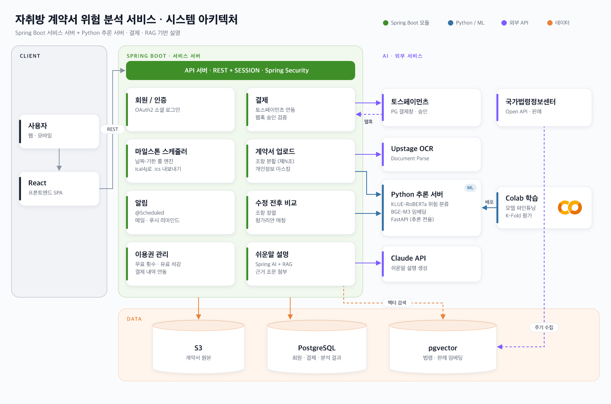

# contractcheck: 자취방 계약서 위험 분석 서비스

[](https://github.com/ContractCheck-MJU/BE/actions/workflows/ci.yml)

자취방 임대차 계약서의 불공정·위험 조항을 찾아 쉬운 말로 설명하고, 수정 전후 비교와 일정·알림을 돕는 서비스의 백엔드 레포지토리입니다. 주 사용자는 임차인(자취생)입니다.

API, 에러 코드, DB 스키마는 [스펙시트](https://docs.google.com/spreadsheets/d/1wjLgLhIR7CT9lP263eIHSWrxBBgrc9r0b7nUlRxKGbI/edit)를 기준으로 합니다.

## 아키텍처

### 시스템 아키텍처



- Spring Boot 앱이 DB, 인증, OCR, LLM, 결제를 소유
- 인증: 세션 쿠키(`SESSION`, Spring Session JDBC)
- 추론 서버는 FastAPI
  - 허용 경로:
    - `POST /classify`
    - `POST /embed`
    - `GET /health`
    - `POST /models/reload`
- 그림의 S3, Spring AI, ical4j는 계획 단계. 아직 의존성에 없음

패키지와 계층 규칙은 [docs/steering/structure.md](docs/steering/structure.md)에 있습니다.

## 사용 스택

- Java: 21 toolchain (`settings.gradle`의 foojay resolver)
  - Spring Boot: 4.1.2 (`build.gradle`)
  - Gradle: 9.8.2 (Wrapper)
  - Spring Security: 7 (Boot 포함)
  - Spring Session: JDBC
  - Hibernate: 7 (Boot 포함)
  - 스키마 마이그레이션: Flyway 12 + `flyway-database-postgresql`
  - springdoc-openapi: 3.2.0 (Swagger UI). 설명은 `src/main/resources/openapi/api-docs.yml`
  - 테스트 DB: H2 (`test` 프로필, PostgreSQL 모드)
  - Lombok, Fixture Monkey: 컴파일·테스트
- PostgreSQL: 16 + pgvector (`pgvector/pgvector:pg16`)

프로필:

- `local`: 기본
- `dev`, `prod`
- 세 프로필 모두 같은 PostgreSQL 변수(`DB_URL`, `DB_USERNAME`, `DB_PASSWORD`) 사용
- `test`: 테스트 전용, H2

## 진행 상황

### 현재 백엔드 골격

- HTTP API와 DTO, `SecurityConfig`(세션 쿠키 `SESSION`, CSRF SPA, 토스 웹훅 CSRF 예외, 미인증 401) 구성. 컨트롤러는 스펙 경로의 목 응답 반환
- 저장소: 인메모리(`ConcurrentHashMap`). Flyway `V1__init.sql` 스키마는 있으나 JPA 영속화는 아직
- Swagger(`local`/`dev`), Actuator(`health`, `info`), CI(`./gradlew test`) 적용
- 외부 연동: 소셜 로그인(OAuth2), Upstage OCR, FastAPI 추론 클라이언트, Claude, 토스 결제 모두 `TODO(FR-…)` 주석만 있고 구현 전
- FastAPI 서버 코드는 이 저장소에 없음

## 빠른 시작

이 프로젝트는 Java 21 toolchain을 사용합니다. JDK 21이 설치되어 있지 않아도 Gradle의 foojay resolver(`settings.gradle`)가 toolchain을 자동으로 내려받습니다.

`bootRun`은 `.env`를 읽지 않습니다. `.env`는 Docker Compose가 DB 컨테이너를 만들 때 사용하고, `bootRun`에는 DB 접속 정보를 환경 변수로 넘겨야 합니다. `DB_URL`과 `DB_USERNAME`은 기본값(`jdbc:postgresql://localhost:5432/contractcheck`, `contractcheck`)이 있어 보통 `DB_PASSWORD`만 지정하면 됩니다.

### macOS

**JDK 환경 변수 설정 (선택)**

터미널의 기본 JDK가 8 등 다른 버전으로 잡혀 있다면 `JAVA_HOME`을 JDK 21로 지정합니다.

```bash
export JAVA_HOME=$(/usr/libexec/java_home -v 21)
```

**환경 설정 파일 준비**

```bash
cp .env.example .env          # DB_PASSWORD를 설정합니다. .env는 커밋하지 않습니다.
```

**PostgreSQL 실행**

로컬에 Postgres 컨테이너가 없다면 Compose로 DB만 먼저 실행합니다.

```bash
docker compose up -d postgres
```

**애플리케이션 실행**

`DB_PASSWORD`에는 `.env`에 넣은 값과 같은 비밀번호를 사용합니다.

```bash
DB_PASSWORD=*** ./gradlew bootRun    # local 프로필, http://localhost:8080
```

### Windows

**JDK 환경 변수 설정 (선택)**

시스템 환경 변수의 `JAVA_HOME`을 JDK 21 설치 경로로 지정하거나 터미널에서 임시로 설정합니다.

PowerShell:

```powershell
$env:JAVA_HOME="C:\Program Files\Eclipse Adoptium\jdk-21.x.x-hotspot"
```

CMD:

```cmd
set JAVA_HOME=C:\Program Files\Eclipse Adoptium\jdk-21.x.x-hotspot
```

**환경 설정 파일 준비**

PowerShell:

```powershell
Copy-Item .env.example .env   # DB_PASSWORD를 설정합니다. .env는 커밋하지 않습니다.
```

CMD:

```cmd
copy .env.example .env
```

**PostgreSQL 실행**

로컬에 Postgres 컨테이너가 없다면 Compose로 DB만 먼저 실행합니다.

```powershell
docker compose up -d postgres
```

**애플리케이션 실행**

`DB_PASSWORD`에는 `.env`에 넣은 값과 같은 비밀번호를 사용합니다.

PowerShell:

```powershell
$env:DB_PASSWORD="***"
.\gradlew.bat bootRun         # local 프로필, http://localhost:8080
```

CMD:

```cmd
set DB_PASSWORD=***
gradlew.bat bootRun
```

### 공통 참고사항

- 기존 DB 재사용: 이미 `contractcheck-postgres` 컨테이너와 볼륨이 있다면 다시 만들지 않습니다. `.env`의 `DB_PASSWORD`를 볼륨을 처음 만들 때 쓴 값과 맞추면 됩니다.
- IntelliJ 실행: 메인 클래스 `ac.mju.contractcheck.ContractcheckApplication`을 실행합니다. 프로젝트 SDK를 21로 설정하고, Run Configuration의 환경 변수에 `DB_PASSWORD`를 등록합니다. 기본값과 다른 DB를 쓴다면 `DB_URL`, `DB_USERNAME`도 등록합니다. (기본 프로필: `local`, 포트: 8080)

## Docker

이미지 정의:

- 저장소 루트 `Dockerfile`
- 멀티 스테이지: `./gradlew bootJar` 빌드 후 Eclipse Temurin 21 JRE에서 실행
- 컨테이너 앱 포트: 8080
- 기본 `LOG_PATH`: `/var/log/contractcheck`

### Compose로 앱과 DB를 함께 실행하기

```bash
cp .env.example .env          # DB_PASSWORD를 설정합니다
docker compose up --build     # local 프로필, 앱 http://localhost:8080, DB localhost:5432
docker compose down           # 볼륨(pgdata)은 유지됩니다

docker compose -f docker-compose.prod.yml up -d --build
# prod 프로필. DB 포트는 호스트에 열지 않고, ./logs를 컨테이너 로그 경로에 마운트합니다.
```

`docker compose up`은 앱을 **8080**에 띄우고 `postgres` 서비스도 함께 시작합니다. IntelliJ가 이미 8080을 쓰고 있거나 기존 `contractcheck-postgres`를 다시 만들면 안 되는 경우에는 아래 절차를 사용합니다.

이미지만 만들 때는 `docker build -t contractcheck .`를 실행합니다.

### 기존 Postgres를 재사용하고 앱만 8081에 띄우기

IntelliJ(8080)와 기존 `contractcheck-postgres`는 그대로 두고, 이미지만 빌드해 앱 컨테이너를 띄웁니다. Compose로는 앱을 올리지 않습니다.

```bash
docker build -t contractcheck:local .

# 기존 컨테이너를 교체할 때
docker stop contractcheck-app && docker rm contractcheck-app

# DB_PASSWORD는 셸에 export하되 명령이나 로그에 출력하지 않습니다.
# 예: 이미 떠 있는 contractcheck-postgres의 POSTGRES_PASSWORD를 그대로 사용합니다.

docker run -d \
  --name contractcheck-app \
  --add-host=host.docker.internal:host-gateway \
  -p 8081:8080 \
  -v "$PWD/logs:/var/log/contractcheck" \
  -e SPRING_PROFILES_ACTIVE=dev \
  -e LOG_PATH=/var/log/contractcheck \
  -e DB_URL=jdbc:postgresql://host.docker.internal:5432/contractcheck \
  -e DB_USERNAME=contractcheck \
  -e DB_PASSWORD \
  contractcheck:local
```

중지·재배포할 때는 `docker stop contractcheck-app && docker rm contractcheck-app` 후 같은 `docker run`을 다시 실행합니다. `contractcheck-postgres`는 중지·삭제·재생성하지 않습니다.

이 방식으로 띄웠다면 아래 URL의 포트를 **8081**로 바꿔서 접속합니다. Flyway가 적용한 스키마 버전은 기동 로그에서 확인할 수 있습니다.

## URL

기준: `local`/`dev` 프로필. 포트는 `bootRun`·Compose 8080, 단독 컨테이너 8081. `prod`는 Swagger와 `/v3/api-docs` 비활성화.

- [`/swagger-ui.html`](http://localhost:8080/swagger-ui.html): Swagger UI로 리다이렉트
- [`/swagger-ui/index.html`](http://localhost:8080/swagger-ui/index.html): Swagger UI
- [`/v3/api-docs`](http://localhost:8080/v3/api-docs): OpenAPI JSON
- [`/actuator/health`](http://localhost:8080/actuator/health): 헬스 체크. 공개, `{"status":"UP",...}`
- `/actuator/info`: 앱 정보. 공개

인증·CSRF:

- 미인증 API: 401
- CSRF: `XSRF-TOKEN` 쿠키 + `X-XSRF-TOKEN` 헤더
- CSRF 예외: 토스 웹훅 `/api/v1/payments/webhooks/toss`

## 테스트

```bash
./gradlew test
./gradlew test --tests ac.mju.contractcheck.domain.RiskLevelResolverTest
```

테스트는 `src/test/resources/application-test.yml`의 `test` 프로필과 인메모리 H2를 사용합니다. 외부 서비스와 로컬 PostgreSQL은 필요 없습니다. 세부 규칙은 [docs/steering/testing.md](docs/steering/testing.md)에 있습니다.

## CI

[`.github/workflows/ci.yml`](.github/workflows/ci.yml)

- 트리거: `main` push, pull request
- 실행: Temurin 21로 `./gradlew test`
- 워크플로 `CI`, 잡 `test`
- 같은 브랜치의 이전 실행은 취소

## 로깅

- 콘솔: 모든 프로필
- 파일: `dev`/`prod`만. `LOG_PATH`(기본 `./logs`, 컨테이너 `/var/log/contractcheck`)에 ECS JSON 롤링
- 에러 로그: `dev`/`prod`만. `logback-spring.xml`이 `contractcheck-error.log`를 별도 롤링
- 요청 상관 ID: `X-Request-Id` 헤더, MDC `requestId`
- 기록 금지: 비밀값, 계약 원문, SQL 바인딩 값

경로·레벨·ELK 계획은 [docs/logging.md](docs/logging.md)에 있습니다.

## 설정 파일

- `application.yml`: 공통. 기본 `local`, DB·Flyway·Session JDBC, `ddl-auto=validate`, 세션 30분. `dev`/`prod` 파일·액세스 로그
- `application-local.yml`: SQL 디버그, 콘솔 패턴, Swagger CSRF
- `application-dev.yml`: 앱 INFO, 라이브러리 WARN, Swagger CSRF
- `application-prod.yml`: 앱 INFO, 루트 WARN, Swagger 끔
- `logback-spring.xml`: 프로필별 appender, `dev`/`prod` 에러 로그 파일 롤링
- `src/test/resources/application-test.yml`: 테스트 H2, 로그 억제
- `src/main/resources/db/migration/V1__init.sql`: 스펙 DB 스키마. pgvector 필요
- `src/main/resources/openapi/api-docs.yml`: Swagger 설명. 컨트롤러 애노테이션으로 대체하지 않음
- `docker-compose.yml`: 로컬 앱+DB (`local`, 8080)
- `docker-compose.prod.yml`: 배포 (`prod`, DB 포트 닫힘, `./logs` 마운트)
- `.env.example`: `DB_PASSWORD`, `LOG_PATH`. 복사한 `.env`는 커밋하지 않음

## 문서

- [스펙시트](https://docs.google.com/spreadsheets/d/1wjLgLhIR7CT9lP263eIHSWrxBBgrc9r0b7nUlRxKGbI/edit): API, 에러 코드, DB 스키마, FR/TC
- [CONTRIBUTING.md](CONTRIBUTING.md): 브랜치·PR·셀프 머지(사람용)
- [AGENTS.md](AGENTS.md): AI 에이전트 핵심 규칙
- [docs/steering/](docs/steering/): 제품, 기술, 구조, 컨벤션, 테스트, 보안, 작업 흐름
- [docs/logging.md](docs/logging.md): 로그 경로, 롤링, 프로필 레벨, ELK
- [docs/erd/](docs/erd/): ERD 원본 JSON

## 라이선스

라이선스는 없으며, 모든 권리는 ContractCheck-MJU 팀에 있습니다(All rights reserved).
