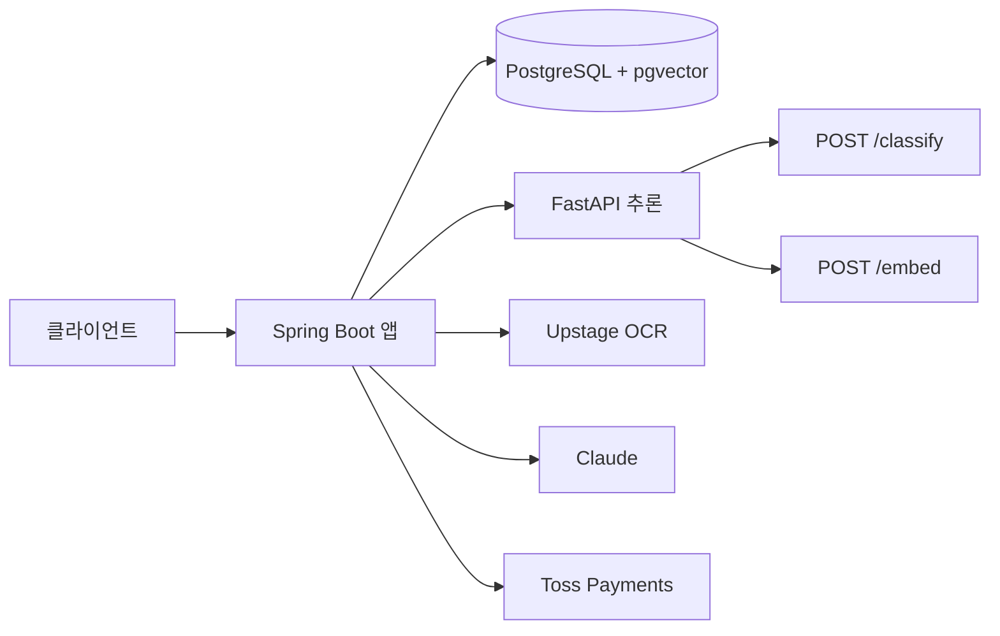

# contractcheck — 자취방 계약서 위험 분석 서비스

[](https://github.com/ContractCheck-MJU/BE/actions/workflows/ci.yml)

자취방 임대차 계약서의 불공정·위험 조항을 찾아 쉬운 말로 설명하고, 수정 전후 비교와 일정·알림을 돕는 서비스다. 주 사용자는 임차인(자취생)이다.

[스펙시트](https://docs.google.com/spreadsheets/d/1wjLgLhIR7CT9lP263eIHSWrxBBgrc9r0b7nUlRxKGbI/edit)가 API·에러 코드·DB 스키마의 근거다. 사람 기여 안내는 [CONTRIBUTING.md](CONTRIBUTING.md), AI 에이전트 규칙은 [AGENTS.md](AGENTS.md)와 [docs/steering/](docs/steering/)다. 라이선스는 없으며, 모든 권리는 ContractCheck-MJU 팀에 있다(All rights reserved).

> 스펙시트 '개요' 탭이 Java 17 · Spring Boot 3.x로 남아 있을 수 있다. 이 저장소의 기준은 Spring Boot 4.1.2 · Java 21이다.

## 아키텍처

Spring Boot 앱이 DB, 인증, OCR, LLM, 결제를 소유한다. 추론 서버는 FastAPI이며 허용 경로는 `POST /classify`, `POST /embed`, `GET /health`, `POST /models/reload`뿐이다. 벡터 검색은 우리 테이블에 대한 native SQL(`ORDER BY embedding <=> ?`)이다.



패키지와 계층 규칙은 [docs/steering/structure.md](docs/steering/structure.md)다.

## 스택

| 구성 | 버전·비고 |
|---|---|
| Spring Boot | 4.1.2 (`build.gradle`) |
| Java | 21 toolchain (`settings.gradle`의 foojay resolver) |
| Gradle | 9.8.2 (Wrapper) |
| Spring Security | 7 (Boot 포함) |
| Spring Session | JDBC |
| Hibernate | 7 (Boot 포함) |
| Flyway | 12 + `flyway-database-postgresql` |
| springdoc-openapi | 3.2.0 (Swagger UI). 설명은 `src/main/resources/openapi/api-docs.yml` |
| PostgreSQL | 16 + pgvector (`pgvector/pgvector:pg16`) |
| 테스트 DB | H2 (`test` 프로필, PostgreSQL 모드) |
| Lombok, Fixture Monkey | 컴파일·테스트 |

프로필은 `local`(기본), `dev`, `prod`다. 세 프로필 모두 같은 PostgreSQL 변수(`DB_URL`, `DB_USERNAME`, `DB_PASSWORD`)를 쓴다. 테스트만 `test` 프로필의 H2다.

## 현재 진행

지금은 백엔드 골격이다.

- HTTP API와 DTO, `SecurityConfig`(세션 쿠키 `SESSION`, CSRF SPA, 미인증 401)가 있다. 컨트롤러는 스펙 경로의 목 응답을 돌린다.
- 저장소는 인메모리(`ConcurrentHashMap`)다. Flyway `V1__init.sql` 스키마는 있으나 JPA 영속화는 아직이다.
- Swagger(`local`/`dev`), Actuator(`health`, `info`), CI(`./gradlew test`)가 붙어 있다.
- 소셜 로그인(OAuth2), Upstage OCR, FastAPI 추론 클라이언트, Claude, 토스 결제 등 외부 연동은 `TODO(FR-…)` 주석만 있고 구현 전이다. FastAPI 서버 코드는 이 저장소에 없다.

## 빠른 시작

macOS 터미널의 기본 JDK가 8인 경우가 많다. 이 프로젝트는 **Java 21** toolchain이다. `JAVA_HOME`을 JDK 21로 맞춘다. 예:

```bash
export JAVA_HOME=/Users/<you>/Library/Java/JavaVirtualMachines/azul-24.0.2/Contents/Home
# 또는 로컬에 설치한 Temurin 21 경로
```

터미널에 JDK 21이 없어도 Gradle은 `settings.gradle`의 foojay resolver로 toolchain을 받을 수 있다. IntelliJ는 프로젝트 SDK를 21로 직접 지정한다.

```bash
cp .env.example .env          # DB_PASSWORD를 설정한다. .env는 커밋하지 않는다.

# 아직 Postgres가 없으면 compose로 DB만 띄운다.
docker compose up -d postgres

DB_URL=jdbc:postgresql://localhost:5432/contractcheck \
DB_USERNAME=contractcheck \
DB_PASSWORD=*** \
./gradlew bootRun             # local 프로필, http://localhost:8080
```

이미 `contractcheck-postgres` 컨테이너와 볼륨이 있으면 다시 만들지 않는다. `.env`의 `DB_PASSWORD`를 볼륨을 처음 만들 때 쓴 값과 맞추면 된다.

IntelliJ에서는 메인 클래스 `ac.mju.contractcheck.ContractcheckApplication`을 실행한다. 프로젝트 SDK는 21, 환경변수는 위와 같고, 기본 프로필은 `local`, 포트는 8080이다.

## Docker

이미지 정의는 저장소 루트 `Dockerfile`이다. 멀티 스테이지로 `./gradlew bootJar`를 만든 뒤 Eclipse Temurin 21 JRE에서 실행한다. 컨테이너 안의 앱 포트는 8080, 기본 `LOG_PATH`는 `/var/log/contractcheck`다.

### 처음부터 compose로 앱과 DB를 함께

```bash
cp .env.example .env          # DB_PASSWORD를 설정한다
docker compose up --build     # local 프로필, 앱 http://localhost:8080, DB localhost:5432
docker compose down           # 볼륨(pgdata)은 유지된다

docker compose -f docker-compose.prod.yml up -d --build
# prod 프로필. DB 포트는 호스트에 열지 않고, ./logs 를 컨테이너 로그 경로에 붙인다.
```

`docker compose up`은 앱을 **8080**에 붙이고 `postgres` 서비스도 시작한다. 이미 IntelliJ가 8080을 쓰거나, 기존 `contractcheck-postgres`를 재생성하면 안 되는 경우에는 아래 "앱만 8081" 절차를 쓴다.

이미지만 만들 때는 `docker build -t contractcheck .` 이다.

### 기존 Postgres를 재사용하고 앱만 8081에 올리기

IntelliJ(8080)와 기존 `contractcheck-postgres`를 그대로 둔 채 이미지만 빌드해 앱 컨테이너를 띄운다. compose로 앱을 올리지 않는다.

```bash
docker build -t contractcheck:local .

# 기존 컨테이너를 교체할 때
docker stop contractcheck-app && docker rm contractcheck-app

# DB_PASSWORD는 셸에 내보내되 명령이나 로그에 인쇄하지 않는다.
# 예: 이미 떠 있는 contractcheck-postgres의 POSTGRES_PASSWORD를 그대로 쓴다.

docker run -d \
  --name contractcheck-app \
  --add-host=host.docker.internal:host-gateway \
  -p 8081:8080 \
  -v "$PWD/logs:/var/log/contractcheck" \
  -e SPRING_PROFILES_ACTIVE=dev \
  -e LOG_PATH=/var/log/contractcheck \
  -e DB_URL=jdbc:postgresql://host.docker.internal:5432/contractcheck \
  -e DB_USERNAME=contractcheck \
  -e DB_PASSWORD \
  contractcheck:local
```

중지·재배포는 `docker stop contractcheck-app && docker rm contractcheck-app` 후 같은 `docker run`을 다시 실행한다. `contractcheck-postgres`는 stop/rm/재생성하지 않는다.

`dev` 프로필이면 아래 URL의 포트를 **8081**로 바꾼다. Flyway는 기동 로그에서 스키마 버전을 확인할 수 있다.

## URL

`local`/`dev` 기준이다. `bootRun`·compose 앱은 8080, 위의 단독 컨테이너는 8081이다. `prod`에서는 Swagger와 `/v3/api-docs`를 열지 않는다.

| 경로 | 설명 |
|---|---|
| [`/swagger-ui.html`](http://localhost:8080/swagger-ui.html) | Swagger UI로 리다이렉트 |
| [`/swagger-ui/index.html`](http://localhost:8080/swagger-ui/index.html) | Swagger UI |
| [`/v3/api-docs`](http://localhost:8080/v3/api-docs) | OpenAPI JSON |
| [`/actuator/health`](http://localhost:8080/actuator/health) | 헬스. 공개, `{"status":"UP",...}` |
| `/actuator/info` | 앱 정보. 공개 |

미인증 API는 401이다. CSRF는 `XSRF-TOKEN` 쿠키와 `X-XSRF-TOKEN` 헤더다.

## 테스트

```bash
./gradlew test
./gradlew test --tests ac.mju.contractcheck.domain.RiskLevelResolverTest
```

테스트는 `src/test/resources/application-test.yml`의 `test` 프로필과 인메모리 H2를 쓴다. 외부 서비스와 로컬 PostgreSQL은 필요 없다. 규칙의 세부는 [docs/steering/testing.md](docs/steering/testing.md)다.

## CI

[`.github/workflows/ci.yml`](.github/workflows/ci.yml)이 `main` push와 pull request에서 Temurin 21으로 `./gradlew test`를 실행한다. 워크플로 이름은 `CI`, 잡 이름은 `test`다. 동시 실행은 취소한다.

## 로깅

콘솔은 항상 연다. `dev`/`prod`는 `LOG_PATH`(기본 `./logs`, 컨테이너는 `/var/log/contractcheck`)에 ECS JSON 파일을 롤링한다. 요청 상관 ID는 `X-Request-Id`와 MDC `requestId`다. 비밀값·계약 원문·SQL 바인딩 값은 남기지 않는다. 경로·레벨·ELK 계획은 [docs/logging.md](docs/logging.md)다.

## 설정 파일

| 파일 | 용도 |
|---|---|
| `application.yml` | 공통 이름, 기본 프로필 `local`, PostgreSQL, Flyway, Session JDBC, `ddl-auto=validate`, 세션 30분. `dev`/`prod` 공통 파일 로그·Tomcat 액세스 로그 |
| `application-local.yml` | local. SQL 디버그, 사람용 콘솔 패턴, Swagger CSRF |
| `application-dev.yml` | dev. 앱 INFO, 라이브러리 WARN, Swagger CSRF |
| `application-prod.yml` | prod. 앱 INFO, 루트 WARN, Swagger 끄기 |
| `src/test/resources/application-test.yml` | 테스트 전용 H2, 로그 억제 |
| `src/main/resources/db/migration/V1__init.sql` | 스펙시트 DB 스키마. pgvector 필요 |
| `src/main/resources/openapi/api-docs.yml` | Swagger 설명. 컨트롤러 애노테이션으로 대체하지 않는다 |
| `docker-compose.yml` | 로컬: 앱+DB, 프로필 `local`, 포트 8080 |
| `docker-compose.prod.yml` | 배포: 프로필 `prod`, DB 포트 닫힘, `./logs` 마운트 |
| `.env.example` | `DB_PASSWORD`, `LOG_PATH` 예시. 복사한 `.env`는 커밋하지 않는다 |

## 문서

- [스펙시트](https://docs.google.com/spreadsheets/d/1wjLgLhIR7CT9lP263eIHSWrxBBgrc9r0b7nUlRxKGbI/edit) — API, 에러 코드, DB 스키마, FR/TC
- [CONTRIBUTING.md](CONTRIBUTING.md) — 브랜치·PR·셀프 머지(사람용)
- [AGENTS.md](AGENTS.md) — AI 에이전트 핵심 규칙
- [docs/steering/](docs/steering/) — 제품, 기술, 구조, 컨벤션, 테스트, 보안, 작업 흐름
- [docs/logging.md](docs/logging.md) — 로그 경로, 롤링, 프로필 레벨, ELK
