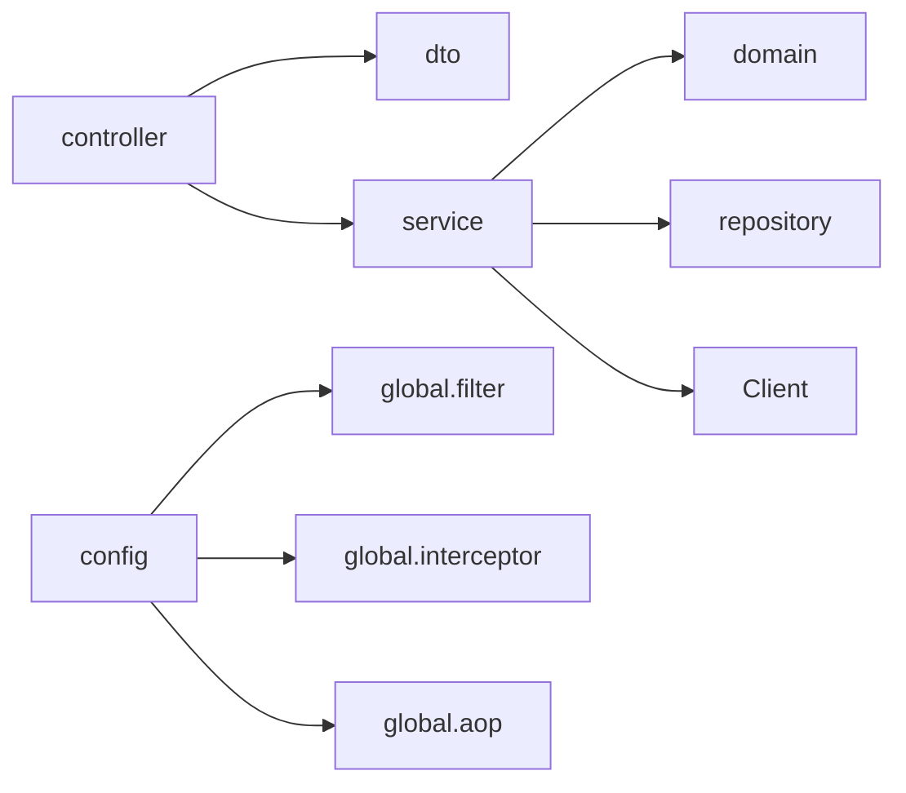

# 구조

패키지와 계층 책임, 리소스 위치. 클래스·변수 이름 세칙은 [conventions.md](conventions.md), 스택·클라이언트는 [tech.md](tech.md)를 본다.

## 패키지 트리

계층형이다. DDD도, 기능별 루트 패키지도 아니다. `dto`만 기능별 하위 패키지를 둔다.

```
ac.mju.contractcheck
├─ controller
├─ service
├─ repository
├─ domain
├─ dto
│  ├─ common
│  └─ <기능>/
├─ config
└─ global
   ├─ error
   ├─ security
   ├─ filter
   ├─ interceptor
   └─ aop
```

`global/filter`, `global/interceptor`, `global/aop`는 둘 위치다. 아직 없으면 필요할 때 이 이름으로 만든다.

계약과 분석처럼 기능이 둘 이상이면 `service`의 유스케이스가 조합한다. 그 사이에 새 패키지를 만들지 않는다.

## 의존 방향



- 허용: `controller` → `service` → `repository`. 컨트롤러는 repository에 접근하지 않는다. ([anti-patterns.md](anti-patterns.md) 1)
- 유스케이스는 `service`에서 상대 도메인·저장소·클라이언트로만 간다.
- `domain`은 Spring, HTTP, DB를 알지 않는다. 비즈니스 규칙은 `domain`에 둔다.
- 서비스끼리 순환 의존을 만들지 않는다. 여러 기능이 만나면 한 유스케이스 서비스가 조합한다. ([anti-patterns.md](anti-patterns.md) 3·4)

## 계층 책임

- **controller**: HTTP 진입점. 요청 바인딩, 인증 주체 전달, DTO 변환, 상태 코드. 유스케이스를 여기에 두지 않는다. ([anti-patterns.md](anti-patterns.md) 2)
- **service**: 유스케이스. 트랜잭션 경계, 권한·소유자 확인 후의 처리, 클라이언트 호출. 만능 클래스로 키우지 않는다.
- **repository**: 저장과 조회. 현재는 인메모리이며, 영속화할 때 시그니처를 유지한다. ([tech.md](tech.md))
- **domain**: 모델과 순수 규칙(`RiskLevelResolver`, `RiskPolicy` 등).
- **dto**: 요청·응답 레코드만 `dto/<기능>/`에 둔다. 공통 래퍼는 `dto.common`이다. 이름은 `<기능><동작>Request` / `<기능><동작>Response`다. 도메인에서 만들 때는 DTO의 `from(...)` 팩토리를 쓴다. 컨트롤러는 domain·entity를 HTTP 응답으로 직접 반환하지 않는다. API마다 DTO를 두고, 여러 API가 하나의 DTO를 공유하지 않는다. `Map<String, Object>`로 요청·응답을 만들지 않는다. ([anti-patterns.md](anti-patterns.md) 6·8·9)
- **config**: 보안, 분석, OpenAPI, 필터·인터셉터·AOP 등록.
- **global**: 현재 사용자, API 예외(`error`), 보안 헬퍼(`security`), 필터·인터셉터·AOP 구현.

엔티티·domain에 웹·문서 애노테이션(`@Json*`, `@Schema`, `@Tag` 등)을 붙이지 않는다. ([tech.md](tech.md), [anti-patterns.md](anti-patterns.md) 7)

## Filter, Interceptor, AOP

- 구현은 `global.filter`, `global.interceptor`, `global.aop`에 둔다.
- 빈 등록과 적용 경로는 `config`에서만 한다.
- 인증·로깅·상관 ID 같은 횡단 관심만 둔다. 비즈니스 규칙을 필터나 AOP에 숨기지 않는다. ([anti-patterns.md](anti-patterns.md) 5)

## 리소스 위치

- OpenAPI: `src/main/resources/openapi/api-docs.yml`
- Flyway: `src/main/resources/db/migration/V{n}__설명.sql`
- 공통·프로필 설정: `src/main/resources/application.yml`, `application-local.yml`, `application-dev.yml`, `application-prod.yml`
- 로그: `src/main/resources/logback-spring.xml`(dev/prod 에러 파일만). 설명은 [logging.md](../logging.md)다.
- 테스트 설정: `src/test/resources/application-test.yml`

## 파일 네이밍

- `@RestController`는 `~RestController`로 끝낸다. 예: `ContractRestController`.
- `@RestControllerAdvice`는 컨트롤러가 아니다. `ApiExceptionHandler`처럼 역할 이름을 쓴다.
- 유스케이스는 `~Service`, 저장소는 `~Repository`로 끝낸다.
- 그 밖의 표기는 [conventions.md](conventions.md)를 따른다.
